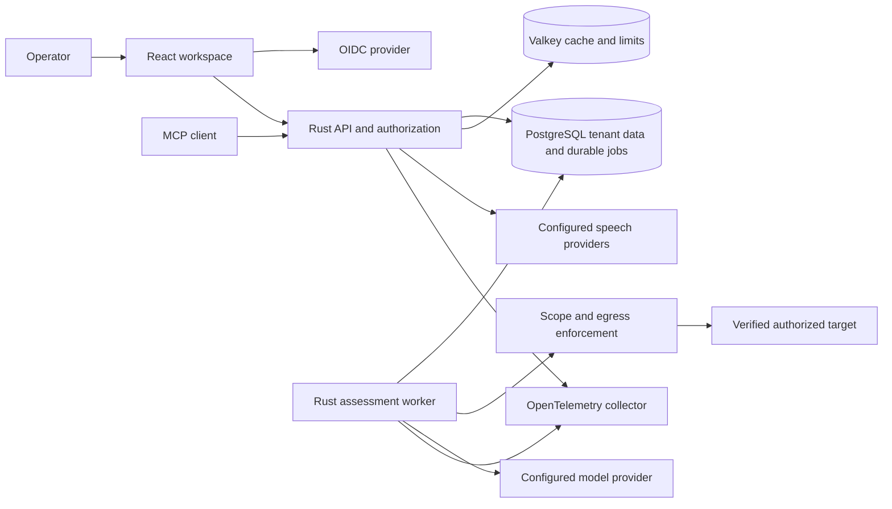

# Karate architecture

Status: target architecture; verify implementation status in the run report.

Implemented at the current checkpoint: [shared domain policy](../components/domain.md),
[tenant/project SQL schema](../components/persistence.md), and the [project API](../components/api.md)
with async PostgreSQL service, signed access-token verification and atomic audit.
[Existing membership administration](../components/membership.md) adds serialized
role/revocation changes and permanent-owner safeguards through that shared service.
[Identity-bound invitations](../components/invitations.md) provide explicit
enrollment/re-enrollment with current delegation, expiry and single-use acceptance.
[Scoped API keys](../components/api-keys.md) now provide hashed-verifier authentication
and audited rotation/revocation through the same service and current policy.
[Trusted provider discovery](../components/identity-refresh.md) now supports bounded
HTTPS key refresh with fail-closed expiry. There is no worker/frontend or full
provider-login workflow yet. The diagram below
remains the target architecture. The API calls the core membership policy after
real credential verification and an async current-membership lookup; the original
synchronous authentication seam remains useful for deterministic domain tests.

Karate uses a modular Rust service, a separately runnable Rust worker, PostgreSQL for durable state/jobs, Valkey for distributed read caching/rate coordination, an OIDC provider, and a React application. REST, MCP and voice invoke the same authorization and domain services. No client or model chooses its own authority.

## Boundaries and persistence

Domain owns lifecycle, roles, budgets, scope rules and evidence classification. Adapters own HTTP, PostgreSQL, identity, provider clients and export formats. Every customer table carries tenant_id and queries require it. Composite foreign keys prevent attaching another tenant's project to an assessment. RLS adds defense in depth using transaction-local tenant context; schema owner credentials must not be the production application identity.

PostgreSQL jobs are durable queue records claimed with SKIP LOCKED, lease timeout and retry count. A transaction creates the assessment and queue message together. Worker execution uses a fencing/lease identifier so an expired worker cannot commit results. No in-memory queue is authoritative. An acknowledged job must survive worker restart.

Cache keys include tenant, permission context and version. Reads requiring current authority, budget or state bypass cache. Project/report summaries may use a short TTL and mutation invalidation. No caching of secrets, bearer credentials or raw target responses. A failed cache can fall back to the authorized database read, with bounded concurrency.

## Identity and trust

Browser OIDC authorization-code + PKCE uses a maintained client, in-memory token storage and a configured trusted issuer. Rust verifies token signature, issuer, audience, expiry and algorithm, then looks up tenant membership in PostgreSQL. OIDC claims do not themselves grant Karate tenant ownership. API keys are random tenant-bound scoped credentials with hashed verifiers, expiry and revocation. Key secrets are returned only on creation.

Control plane: tenant/membership, keys, configuration, budgets and identity onboarding. Data plane: assessment execution and evidence. Already authorized work can continue within its immutable lease/scope and short bounded authority window during control-plane outage; new jobs and changes fail closed. Cancellation and membership revocation are checked between bounded requests. Provider/model failure records partial results and never converts an unchecked endpoint into a pass.

## Agent execution

Model output is a typed proposal, not executable shell. An allowlisted check catalog controls network actions. Resolve and validate DNS at connection time, pin the resolved address, disable ambient proxies and automatic redirects, reject metadata/private ranges unless a separately authorized private connector is used. Every redirect/new endpoint re-enters the policy boundary. Request/body/time budgets, concurrency and allowed hours are enforced independently of the model.

Evidence distinguishes observation, hypothesis and reproduced finding. The scanner cannot claim exploitation from a missing header. Sensitive response material is bounded/redacted; tenant-owned evidence retention is configurable. A report is a snapshot with scope, versions, check counts and limitations.

## Availability and recovery

IdP outage blocks new login; already valid signatures may be checked only with trusted cached keys within their documented lifetime. PostgreSQL outage blocks mutations and job claims. Broker/queue lease recovery must not repeat consequential effects. Model/voice failure leaves useful text/API actions available. OTel failure drops bounded telemetry rather than blocking customer work. Backup/restore and key rotation must be verified before release.

Diagrams are source artifacts; render verification is pending until the selected documentation tooling is available.
